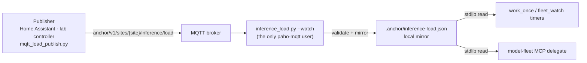

# Site load via MQTT

Cap **local inference** across every Anchor project on a site from one published
signal. An operator — a home-energy automation, a lab controller, a UPS monitor —
publishes a **load level** to an MQTT topic; each project honors it before
claiming plans or delegating to local endpoints.

This governs **local / self-hosted** endpoints only. Cloud API tiers are never
blocked by a site power policy.

It is **opt-in**. With nothing configured the resolved level is `high` from
source `disabled`, and every worker behaves exactly as it did before.

## Why

A local fleet otherwise pulls `.plans/` and drives local endpoints until the box
or the API falls over. There was no shared, real-time way to say:

- *grid peak — local inference **off***
- *solar surplus — allow **full** local load*
- *shared UPS — **mid** only*

See [Solar: powering local compute](/savings#solar-powering-local-compute) for
the cost side of the same problem: a site-wide kWh cap pairs naturally with a
central load signal.

## How it fits together



The subscriber is the only component that needs `paho-mqtt`. Every consumer
reads the JSON mirror with the standard library, so a load check adds no
dependency, no socket, and no stall to the claim path — and a broker outage can
never hang a worker.

Writing that mirror by hand, or from any other bus, is a supported way to run
this **without MQTT at all**:

```bash
python scripts/inference_load.py --set low --reason grid-peak
```

## Levels

| Level | Allowed local fit tiers | Meaning |
|-------|------------------------|---------|
| `off` | (none) | No local inference |
| `low` | `small` | Minimal — tiny/swarm executors only |
| `mid` | `small`, `mid` | Normal local work; no heavy tiers |
| `high` | `small`, `mid`, `reasoner`, `frontier` | Full local load within endpoint capacity |

Aliases: `0`–`3`, `full`→`high`, `none`→`off`. An unknown level is a **parse
error** — a malformed message is dropped, never applied, and can never widen the
cap.

## Topic and payload

```text
anchor/v1/sites/{site_id}/inference/load          # site policy
anchor/v1/sites/{site_id}/projects/{slug}/load    # optional per-project override
```

The project topic **outranks** the site topic while its message is fresh — that is
what a per-project cap is for. The two are mirrored under separate scopes, so a
periodic site heartbeat cannot erase a standing override. A project override that
goes stale falls through to the **site** policy rather than to the fail-safe, so an
abandoned per-project topic cannot strand a project the site is still governing.

```json
{
  "level": "low",
  "max_concurrent_local": 1,          // advisory only — see below
  "allowed_tiers": ["small", "mid"],
  "reason": "grid-peak",
  "site_id": "garage",
  "ts": "2026-07-09T12:00:00Z",
  "ttl_s": 120
}
```

Only `level` is required. An explicit `allowed_tiers` replaces the level's
default row; `level: off` denies regardless.

`max_concurrent_local` is **advisory metadata**: it is carried, mirrored, and
shown, but nothing enforces a concurrency cap today — a per-invocation, file-only
read path cannot count what other processes are doing. Use `level` and
`allowed_tiers` for anything that must actually bite.

## Freshness and fail-safe

`ttl_s` is measured against **local receipt time**, not the publisher's `ts` — a
publisher with a skewed clock cannot hand out an immortal "full load" message.

A payload that omits `ttl_s` expires after **`ANCHOR_LOAD_MAX_AGE`** (default
`900`s) instead. Freshness is the **consumer's** guarantee: a publisher must not
be able to opt out of expiry by leaving a field blank, or a retained
`{"level":"high"}` would outlive a dead publisher forever. Set the ceiling to `0`
to opt out explicitly; `--status` warns whenever a live policy is relying on it.

When no fresh policy is available (never received, broker down, TTL or ceiling
elapsed) the configured fail-safe applies:

| `ANCHOR_LOAD_FAILSAFE` | Behavior |
|------------------------|----------|
| `hold` (default) | Treat as `off` — safe for shared power/thermal |
| `last_known` | Keep the stale level (labs, air-gapped runs) |
| `unrestricted` | Treat as `high` — opts out of the safety property |

A corrupt or unreadable mirror falls back the same way. The default direction of
failure is **stop**, not proceed.

## Which endpoints count as local

Explicit wins, heuristic fills in:

```yaml
- name: h100-executor
  tier: executor-heavy
  base_url: http://10.0.1.10:8000/v1
  model: Qwen/Qwen3-32B-FP8
  local: true          # your rack, your power bill
```

Without `local:`, an endpoint is local when its base URL is loopback, an RFC1918
/ CGNAT / link-local address, or a `.local`/`.lan`/`.internal` hostname. Every
public hostname is treated as **not** local, so a mis-set policy cannot silently
block a cloud tier. Set `local: true` for a tunnelled public URL that really is
your hardware, or `local: false` for a private-range box someone else powers.

## Configuration

Environment wins over an optional `.anchor/mqtt-load.yaml` (or
`~/.config/anchor/mqtt-load.yaml`, same keys lowercased without the prefix).

| Variable | Meaning |
|----------|---------|
| `ANCHOR_MQTT_URL` | `mqtt://host:1883` (`mqtts://` for TLS) |
| `ANCHOR_MQTT_SITE` | Site id — builds the default topic |
| `ANCHOR_MQTT_TOPIC` | Explicit topic, overriding the derived one |
| `ANCHOR_MQTT_PROJECT` | Project slug for the per-project override topic |
| `ANCHOR_MQTT_USERNAME` / `ANCHOR_MQTT_PASSWORD` | Broker credentials |
| `ANCHOR_LOAD_FAILSAFE` | `hold` \| `last_known` \| `unrestricted` |
| `ANCHOR_LOAD_MAX_AGE` | Seconds a policy **without** `ttl_s` stays fresh (default `900`; `0` disables) |
| `ANCHOR_LOAD_CACHE` | Mirror path (default `.anchor/inference-load.json`) |
| `ANCHOR_LOAD_DISABLE` | `1` forces the governor off |

A broker URL, an explicit topic, or an existing mirror file turns the governor
on. Nothing configured means nothing changes.

## What each consumer does

| Component | Behavior when capped |
|-----------|----------------------|
| [`work_once.py`](/tooling/fleet-workers) | Local-bound worker refuses **before claiming** and exits idle (code `1`) — the backlog is left untouched rather than parked under a lease nobody is running |
| `fleet_watch` timers | Same, via the emitted unit; `--status` shows the current level |
| model-fleet MCP `delegate` | Returns a structured `LOAD-LIMITED` refusal instead of sending work; `list_fleet` shows the level; `fleet_health` still pings (diagnostics stay ungated) but labels capped endpoints |

A worker is *local-bound* when `--endpoint` resolves to a local endpoint, or when
it is told so with `--local-worker` (for tier-only workers). `--ignore-load`
overrides the cap for one run.

## Operator commands

```bash
# What is the current policy, and would a mid-tier local worker run?
python scripts/inference_load.py --status --tier mid

# Subscribe and keep the mirror current (needs paho-mqtt)
python scripts/inference_load.py --watch

# Publish a level to the site topic
python scripts/mqtt_load_publish.py off  --reason grid-peak
python scripts/mqtt_load_publish.py high --reason solar-surplus --ttl 900 --retain
python scripts/mqtt_load_publish.py mid  --dry-run        # print the payload only

# Cap one project instead of the whole site
python scripts/mqtt_load_publish.py off  --project --reason thermal
```

The publisher defaults to the **site** topic even when `ANCHOR_MQTT_PROJECT` is
exported (that variable is what *consumers* set, so defaulting to it would
silently narrow a site-wide cap to one project). `--project` opts into the
override topic and `--topic` forces a literal one; the resolved topic is always
printed.

Retained messages are recommended so a worker starting later still sees the
current level — pair `--retain` with `--ttl` so a retained `high` cannot outlive
the condition that justified it.

Timer-driven workers get a clean environment, so `fleet_watch` copies the load
settings into the units it emits. Unit files and crontabs are world-readable, so
**no secret is written to either**: `ANCHOR_MQTT_PASSWORD` is never emitted, and
any `user:pass@` userinfo in `ANCHOR_MQTT_URL` is **stripped** before the value is
written (that credential is not used for auth anyway — only the host and port are
read from the URL). Supply credentials through `ANCHOR_MQTT_USERNAME` /
`ANCHOR_MQTT_PASSWORD` via a credential file or a systemd drop-in.

## Supervise the writer

The readers are timers; the **mirror writer** is a daemon. If a broker is
configured and nothing runs `--watch`, the default `hold` fail-safe leaves the
fleet permanently capped with no explanation beyond `source=failsafe:hold` — so
emit a unit for it alongside the workers:

```bash
python scripts/fleet_watch.py --project . --emit systemd --load-watcher \
  --worker tier=mid,agent=mid-1,interval=5m
```

That adds `anchor-load-watch-<project>.service` (`Type=simple`, `Restart=always`)
next to the worker timers.

## Security

The signal controls how much of your own hardware runs, so treat write access to
the topic as privileged: use TLS and authentication, keep `site_id` namespaces
separate, and do not allow anonymous publish in production. The payload carries
load policy only — never plan contents.
